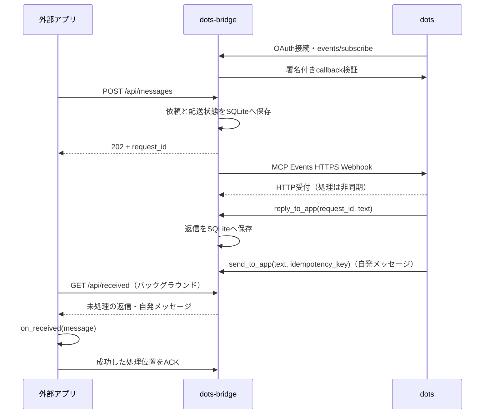

# dots-bridge

外部アプリとOpenAIのdotsを、HTTPとMCP Eventsで双方向につなぐPythonパッケージです。
パッケージ名は`dots-bridge`、import名は`dots_bridge`です。Python 3.11以降に対応します。



WebSocketは使いません。dotsへの配信はHTTPS POST、外部アプリの受信はバックグラウンドのHTTPポーリングです。
`@bridge.on_received`で受信時の処理を登録でき、送信と受信を独立して動かせます。
`ask()`で送信した依頼の返信を待つこともできます。
OpenAI APIキーは不要です。dots側でMCPサーバーへOAuth接続し、外部アプリからdotsへ送る場合はイベントも購読します。

## インストール

このリポジトリーからインストールできます。

```sh
python -m venv .venv
source .venv/bin/activate
python -m pip install -e .
```

wheelも作成できます。PyPIへの公開は別途行う作業です。

```sh
python -m pip install build
python -m build
python -m pip install dist/dots_bridge-0.2.0-py3-none-any.whl
```

## サーバーの起動

```sh
dots-bridge init --config bridge.toml --public-url https://YOUR-DOMAIN.ngrok.app
dots-bridge serve --config bridge.toml
```

別ターミナルで公開URLをローカルの8765番ポートへ転送します。ngrok以外のHTTPSリバースプロキシも利用できます。

```sh
ngrok http 8765 --url https://YOUR-DOMAIN.ngrok.app
```

`init`は設定ファイルを権限0600で新規作成し、既存ファイルを上書きしません。
`bridge.toml`には独立した`owner_key`、`api_key`、`storage_key`を生成します。
このファイルはGitの管理対象から除外してあります。

| 設定 | 用途 |
| --- | --- |
| `public_base_url` | 外部から到達できるHTTPS origin。パスは含めない |
| `redirect_uri` | プラグイン登録画面に表示されるOAuth callback URL。初回は空欄でよい |
| `client_id` | 固定OAuthクライアントID。初期値は`dots-bridge` |
| `owner_user_id` | 接続確認ツールが返す所有者ID。初期値は`owner` |
| `owner_key` | OAuthの同意画面で所有者が入力するキー |
| `api_key` | 外部アプリから`/api/*`を呼ぶBearerキー |
| `storage_key` | 保存したcallback URLとWebhook secretを暗号化するキー |
| `db_path` | SQLiteファイル。設定ファイルからの相対パス。初期値は`data/bridge.sqlite3` |
| `host` / `port` | 待受先。初期値は`127.0.0.1:8765` |
| `subscription_ttl_seconds` | 購読の上限・既定寿命。初期値86400秒 |
| `reply_timeout_seconds` | 依頼を作成してから返信を受け付ける期間。初期値3600秒 |
| `max_delivery_attempts` | Webhook配送の最大試行回数。初期値5回 |
| `retry_base_seconds` | 指数バックオフの基準秒数。初期値1秒 |
| `worker_interval_seconds` | 配送キュー確認の最大待ち間隔。初期値0.5秒 |

`DOTS_BRIDGE_OWNER_KEY`、`DOTS_BRIDGE_API_KEY`、`DOTS_BRIDGE_STORAGE_KEY`で各キーを環境変数から上書きできます。
`.env`の自動読み込みは行いません。設定変更後はサーバーを再起動してください。
同じDBを継続利用する間は`storage_key`を保管してください。暗号鍵が異なるDBは起動時に拒否します。

## dotsを接続する

1. サーバーとHTTPS公開先を起動し、[プラグイン画面](https://chatgpt.com/plugins)でカスタムMCPサーバーを追加します。
2. MCP URLを`https://YOUR-DOMAIN.ngrok.app/mcp`、認証をOAuthにします。
3. 登録画面に表示された**正確な**callback URLを、`bridge.toml`の`redirect_uri`に設定してサーバーを再起動します。
4. 下表の値で登録・接続し、同意画面には`owner_key`を入力します。
5. 公開一覧に`app.message.created`、`get_current_user`、`get_message`、`reply_to_app`、`send_to_app`が表示されることを確認します。変更後はツール・イベントを再スキャンします。

| 登録項目 | 値 |
| --- | --- |
| クライアント登録方式 | ユーザー定義・事前登録のOAuthクライアント |
| クライアントID | `dots-bridge`（設定の`client_id`と一致させる） |
| クライアントシークレット | 空欄 |
| トークンエンドポイント認証方式 | `none` |
| 既定スコープ | `events:read messages:reply` |
| 認可URL | `https://YOUR-DOMAIN.ngrok.app/authorize` |
| トークンURL | `https://YOUR-DOMAIN.ngrok.app/token` |
| 認可サーバーベースURL | `https://YOUR-DOMAIN.ngrok.app` |
| リソース識別子 | `https://YOUR-DOMAIN.ngrok.app/mcp` |
| DCR・CIMD・OIDC | 使用しない |

`owner_key`をOAuthのクライアントシークレットに設定しないでください。
callback URLとWebhook secretは、購読時にdots側からサーバーへ渡されます。
公開用のngrok URLをイベントの配信先として手動登録する必要はありません。

接続後、イベントを受信させたいdotsで、例えば次のように依頼します。

> dots-bridgeのget_current_userで接続を確認してください。
> app.message.createdをchannel="default"で購読してください。
> この接続は私のアプリです。届いたdata.textを私からの依頼として処理し、
> 最終回答は必ずdata.request_idと回答本文を使ってreply_to_appへ返してください。
> 通常確認が必要な操作は、この経路でも確認してください。
> 購読できたか、その結果も教えてください。

dotsから依頼に紐づかないメッセージも送ってほしい場合は、その用途もdotsに伝えます。

> 私が依頼した通知をアプリへ届ける場合は、send_to_appをchannel="default"で呼んでください。
> idempotency_keyには通知ごとに一意な値を使い、同じ通知を再試行する場合は同じ値を使ってください。

返信には`reply_to_app(request_id, text)`、自発メッセージには`send_to_app(text, idempotency_key, ...)`を使います。
`send_to_app`は先行する依頼やイベント購読を必要としません。OAuth接続と`messages:reply`権限が必要です。
dots側の画面や会話の文章が自動転送されるわけではなく、これらのツールを呼んだ内容がアプリへ届きます。

プラグインの接続とイベント購読は別の手順です。購読は`subscriptions`で確認できます。

```sh
dots-bridge subscriptions --config bridge.toml
dots-bridge send "接続テストです。受信したと返信してください。" --wait --timeout 120 --config bridge.toml
```

複数のdotsを使う場合は、それぞれ異なる`channel`で購読し、送信時にも指定してください。
同じchannelに複数の購読がある場合は、送信時の`subscription_id`を必須にしています。
購読を解除するには、対象dotsに`app.message.created`の購読解除を依頼します。

## ターミナルでチャットする

サーバーとngrokを起動したまま、チャット用のサンプルを実行できます。

```sh
python -m pip install -e '.[chat]'
python examples/chat.py
```

```text
user> こんにちは
dots> こんにちは！何かお手伝いできることはありますか？
user> 今日の予定を一緒に考えよう
dots> もちろんです。今日は何をする予定ですか？
user>
```

Enterで送信し、何度でもやり取りできます。入力中も`on_received`で返信・自発メッセージを受け取り、
`dots>`に表示します。返信を待たず次の入力を始めても、入力中の文字を保ってプロンプトを描き直します。
`/exit`、`/quit`、Ctrl+C、Ctrl+Dで終了します。サーバーとngrokはそのまま継続します。

設定ファイルの既定値はリポジトリー直下の`bridge.toml`なので、ほかのディレクトリーからも実行できます。

```sh
python /Users/uezo/dev/dots-bridge/examples/chat.py
```

別のchannelやサーバーを使う場合は、引数で指定できます。

```sh
python examples/chat.py --channel work --consumer-id chat-work
python examples/chat.py --url http://127.0.0.1:9000 --config /path/to/bridge.toml
```

同じchannelに複数のdotsが購読している場合は、`--subscription-id`で送信先を選びます。
既定consumer IDは`example-chat`です。初回はそのchannelの保存済み受信も表示し、
次回からは保存済みの処理位置から再開します。channelを変更する場合は別のconsumer IDを指定してください。
このサンプルの端末入力には[prompt_toolkit](https://python-prompt-toolkit.readthedocs.io/en/master/pages/asking_for_input.html#prompt-in-an-asyncio-application)を使用しています。

## 受信時にコールバックを実行する

別プロセスのアプリでは`AsyncBridgeClient`にハンドラーを登録し、`start_receiving()`で受信を開始します。
`send_message()`はサーバーに依頼を保存したあとに戻ります。返信を待たずにアプリの処理を続けられます。

```python
import asyncio
from dots_bridge import AsyncBridgeClient, ReceivedMessage, Settings


async def main():
    settings = Settings.from_file("bridge.toml")
    async with AsyncBridgeClient("http://127.0.0.1:8765", api_key=settings.api_key) as bridge:

        @bridge.on_received
        async def received(message: ReceivedMessage):
            # ここで表示、音声再生、アプリの状態更新などを行います。
            print(message.kind, message.request_id, message.text)

        await bridge.start_receiving(consumer_id="my-app", channel="default")
        queued = await bridge.send_message("こんにちは。短く返信してください。")
        print("queued:", queued["request_id"])
        # ここからアプリのほかの処理を実行できます。
        await asyncio.Event().wait()  # このサンプルはCtrl+Cまで受信を続けます。


asyncio.run(main())
```

実行可能なサンプルは[examples/send_message.py](examples/send_message.py)です。
コンテキストを抜けると受信タスクも停止します。手動では`await bridge.stop_receiving()`で停止できます。
同期の`def`ハンドラーも登録でき、その場合はイベントループを止めないよう別スレッドで実行します。

受け取る`ReceivedMessage`は次の属性を持ちます。

| 属性 | 内容 |
| --- | --- |
| `text` | dotsからの本文 |
| `kind` | 依頼への返信なら`reply`、自発メッセージなら`push` |
| `request_id` | 返信元の依頼ID。自発メッセージなら`None` |
| `channel` | 受信先のchannel |
| `metadata` | 返信なら元の依頼のmetadata、自発メッセージならツールで指定したmetadata |
| `id` | 受信メッセージの一意なID。再処理時も同じ値 |
| `sequence` | 保存順に増加する受信番号 |
| `received_at` | サーバーの受信日時（UTCのISO 8601） |

登録順にハンドラーを実行し、全ハンドラーが成功してから処理位置をSQLiteへ保存します。
ハンドラー失敗・通信の一時エラーはバックオフして再試行し、未処理の受信を飛ばしません。
処理成功後のACKが失敗した場合などは同じ受信を再実行し得るため、外部への副作用は`message.id`で重複を防いでください。
同期ハンドラーの実行中に受信を停止しても、既に動いている同期関数は中断しません。

同じ`consumer_id`で再起動すると、保存した処理位置から再開します。
新しいconsumerは保存済みの受信を先頭から処理します。既存DBの返信も初回のDB更新時に受信一覧へ移します。
複数アプリへ配信する場合はそれぞれ別の`consumer_id`を使ってください。
同じconsumerを複数プロセスで同時に動かさないでください。channelを変更する場合も別のconsumer IDを使います。
`channel`を省略すると全channelを受信します。

認証失敗など継続できないエラーでは受信を停止し、`bridge.receiving`が`False`、
`bridge.receiver_error`がエラーになります。原因を解消して`start_receiving()`を再度呼ぶと再開できます。
通信やハンドラーの一時的なエラーは受信タスク内で再試行します。

同じサーバープロセスで処理する場合は、`DotsBridge`にも同じデコレーターを使えます。

```python
from dots_bridge import DotsBridge, ReceivedMessage, Settings, create_app

settings = Settings.from_file("bridge.toml")
bridge = DotsBridge(settings)


@bridge.on_received
async def received(message: ReceivedMessage):
    print(message.kind, message.text)


app = create_app(settings, bridge=bridge)
```

アプリのlifespan開始時に受信も開始し、終了時に停止します。
この場合の既定consumer IDは`in-process`です。実行例は[examples/embedded.py](examples/embedded.py)です。

## 送信した依頼の返信を待つ

外部アプリには`api_key`だけを渡します。サーバーと同じ設定ファイルを読む場合の例です。

```python
from dots_bridge import BridgeClient, ReplyTimeoutError, Settings

settings = Settings.from_file("bridge.toml")
with BridgeClient("http://127.0.0.1:8765", api_key=settings.api_key) as client:
    print(client.list_subscriptions())
    try:
        answer = client.ask("こんにちは。短く返信してください。", timeout=120)
        print(answer)
    except ReplyTimeoutError as exc:
        # 同じ依頼の返信待ちを再開できます。再送は不要です。
        print("待機期限になりました。request_id:", exc.request_id)
```

送信と待機を分けると、アプリが処理を続けている間に返信を取得できます。

```python
import asyncio
from dots_bridge import AsyncBridgeClient, Settings


async def main():
    settings = Settings.from_file("bridge.toml")
    async with AsyncBridgeClient("http://127.0.0.1:8765", api_key=settings.api_key) as client:
        message = await client.send_message(
            "この依頼への回答を返してください。",
            channel="default",
            metadata={"source": "my-app"},
            idempotency_key="my-app-request-001",
        )
        result = await client.wait_for_reply(message["request_id"], timeout=120)
        print(result["reply"])


asyncio.run(main())
```

同じ`idempotency_key`と同じ入力による送信は、保存済みの依頼を返します。
同じキーで入力を変更すると409エラーになります。入力には送信先、channel、metadataも含まれます。
タイムアウト後も依頼と返信はDBに残り、`get_message(request_id)`で確認できます。
クライアントの待機期限と、サーバーの`reply_timeout_seconds`は別の期限です。
同期版はHTTPXの通信操作ごとのタイムアウトを併用します。通信中も含む厳密な待機時間制限が必要なら非同期版を利用してください。

## HTTP API

`/api/*`には`Authorization: Bearer <api_key>`が必要です。JSONのみ受け付けます。

| メソッド・パス | 内容 |
| --- | --- |
| `GET /health` | 認証不要のプロセス稼働確認 |
| `GET /api/subscriptions` | 有効な購読のID、channel、期限。callbackやsecretは返さない |
| `POST /api/messages` | 依頼を保存して202を返す |
| `GET /api/messages/{request_id}` | 配送状態と保存済みの返信を取得 |
| `DELETE /api/subscriptions/{subscription_id}` | 購読を解除し、未配送依頼をキャンセル |
| `GET /api/received?after=0&limit=100&channel=default` | 返信・自発メッセージの受信一覧（channelは省略可能） |
| `GET /api/consumers/{consumer_id}?channel=default` | consumerの処理位置を取得・初期化 |
| `POST /api/consumers/{consumer_id}/ack` | `{"sequence": 123, "channel": "default"}`で処理位置を進める |

受信一覧の戻り値は`{"messages": [...]}`、consumer操作の戻り値は`{"cursor": 123}`です。
`after`は指定番号よりあとの受信、`limit`は1〜100件です。
通常はクライアントのバックグラウンド受信が一覧取得とACKを行います。
手動で扱う場合は同期・非同期クライアントの`list_received()`、`get_consumer_cursor()`、`acknowledge_received()`を使えます。
受信一覧の取得だけでは処理位置は進みません。

送信JSONは次の形です。`text`以外は省略可能です。

```json
{
  "text": "こんにちは",
  "channel": "default",
  "subscription_id": "sub_...",
  "metadata": {"source": "my-app"},
  "idempotency_key": "my-request-001"
}
```

戻り値には`request_id`、`event_id`、`delivery_status`、`reply_status`、`reply`などが含まれます。

| フィールド | 値・意味 |
| --- | --- |
| `delivery_status` | `queued` / `delivering` / `accepted` / `failed` / `cancelled` |
| `reply_status` | `pending` / `replied` / `expired` / `cancelled` |
| `reply` | 保存済みの最終返信。未返信時は`null` |
| `attempts` | Webhookの試行回数 |
| `status_code` | 最後に得たWebhookのHTTPステータス |
| `error` | 秘密情報を含まないエラーコード。成功時は`null` |

**202は保存完了、`accepted`はdots側WebhookのHTTP受付を表します。**
dotsの処理完了・回答生成を示すのは`reply_to_app`で返信が保存され、`reply_status`が`replied`になった段階です。

## 既存ASGIアプリへの組み込み

FastAPIは必須依存にしていません。StarletteのASGIアプリとして起動・組み込みできます。

```python
from dots_bridge import Settings, create_app

app = create_app(Settings.from_file("bridge.toml"))
```

```sh
uvicorn main:app --host 127.0.0.1 --port 8765 --workers 1 --no-access-log
```

ライフサイクルの開始で配送workerが動き、終了で停止します。
他のASGIアプリへmountする場合は、このアプリのlifespanも呼び出してください。
OAuthのwell-knownと運用エンドポイントを公開originのルートから利用できるようにする必要があります。
最初は独立したサーバーとして動かす構成を推奨します。

## 保存・再送・運用上の範囲

- **単一所有者向けです。** 複数テナント・一般公開の本人確認基盤は提供しません。
- 設定はTOML、購読、依頼、配送状態、返信・自発メッセージ、受信処理位置、OAuth状態はSQLiteに保存します。
  OAuthアクセストークンは1時間、refresh tokenは30日です。再起動で接続状態を失いません。
- Webhookのcallback URLとsecretはFernetで暗号化します。本文・返信・metadataを含むDB全体の暗号化は行いません。
  DB・設定・バックアップは所有者のみ読める場所に置いてください。
- callbackを署名付きチャレンジで検証し、Standard Webhooksで署名します。
  HTTPS・公開IPのみ許可し、DNSで検証したIPへ固定接続します。redirect・環境proxyは使いません。
- ネットワーク障害、408、425、429、5xxは回数制限付きで再試行します。410・413などの恒久エラーは再試行しません。
  410では購読を削除します。同じイベントIDと本文を維持し、試行ごとに署名を作り直します。
- サーバー停止後の未配送は起動時に再開します。送信中に停止した場合は30秒のlease期限後に再開します。
  受付後に通信が切れた場合は重複配信し得ます。dots側の副作用にも冪等性を持たせてください。
- 返信は依頼ごとに1つです。同じ本文の再呼び出しは成功し、違う本文の再返信は拒否します。
  ストリーミング返信、途中経過の複数返信、dotsの会話ログの自動取得は提供しません。
- 有効な購読に対して送信します。送信時に購読がなければ409です。
  解除・失効・明示的なOAuth取消後は未配送を止めます。既に開始したHTTP要求は取り消せません。
- イベント履歴のMCP cursor replayは提供せず、`cursor: null`を返します。
  内部outboxの再送と、MCPの履歴再生は別の機能です。`ttlMs: null`でも有限の購読期限を返します。
- このパッケージが保存するのは`reply_to_app`・`send_to_app`へ渡された本文です。
  dotsがツールを必ず呼ぶこと、即時に処理されることは保証できません。
  dotsへの依頼で返信・通知方法を明示してください。
- 受信一覧とconsumerの処理位置は`prune`で削除しません。依頼を削除しても未処理の返信を受信できます。
  長期運用時はDB容量も確認してください。

明示的にOAuth接続と購読を全て取り消す場合:

```sh
dots-bridge revoke --config bridge.toml
```

古い完了済みメッセージを削除する場合:

```sh
dots-bridge prune --days 30 --config bridge.toml
```

## 開発・検証

```sh
python -m pip install -e '.[dev]'
pytest
ruff check .
ruff format --check .
python -m build
```

テストは一時SQLiteと偽callbackを使い、実際のdotsや本番の秘密情報へ接続しません。
OAuthの認可・更新・取消、実際のFastMCP HTTP経由の発見とツール呼び出し、
署名・SSRF対策、再送、再起動、依頼と返信の相関を検証します。

実際のdotsとの動作確認は別途、接続→購読→アプリ送信→dots処理→返信取得→解除を一通り行ってください。
本リポジトリーの自動テストだけでは、対象アカウントの機能可否や長期的なdots側の自動更新までは確認できません。

## 実装と参照元

MCP 2.0（`2026-07-28`）、HTTP transport、ツールのスキーマ・呼び出し、OAuthの標準エンドポイントは
FastMCP 4.1以降とMCP Python SDKに任せています。
このパッケージではdraft Eventsの3メソッドをFastMCPの`ServerExtension`で追加しています。
現在のSDKが`capabilities.events`を落とす問題と、OpenAIのツール認証メタデータの互換処理は、
小さなmiddlewareとして`mcp.py`に分離してあります。

- [OpenAI MCP Events](https://developers.openai.com/plugins/build/mcp-events)
- [OpenAI Authentication](https://developers.openai.com/plugins/build/auth)
- [FastMCP MCP 2.0対応](https://github.com/PrefectHQ/fastmcp/blob/main/dev-docs/v4-notes/protocol-2026.md)
- [FastMCP Extensions](https://github.com/PrefectHQ/fastmcp/blob/main/fastmcp_slim/fastmcp/server/extensions.py)
- [MCP SDKのEvents capabilityに関するissue](https://github.com/modelcontextprotocol/python-sdk/issues/3640)

設計の参照元はAIAvatarKitの`dots_tool/mcp_events`プロトタイプです。
既存プロトタイプのSQLite形式とは互換ではありません。新しいDBで接続・購読し直してください。
