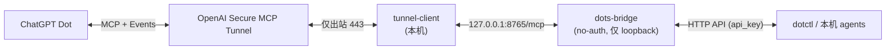

# dots-tunnel-bridge

让本机程序 / agent 与 **ChatGPT Dot** 双向通信：本机不开任何入站端口，经 OpenAI **Secure MCP Tunnel** 出站连接。

基于 [uezo/dots-bridge](https://github.com/uezo/dots-bridge)（MIT，© uezo，原 README 见 [docs/UPSTREAM_README.md](docs/UPSTREAM_README.md)），本仓库保留了上游完整历史和 [LICENSE](LICENSE)。



## 相对上游的改动

| 改动 | 说明 |
|---|---|
| `DOTS_BRIDGE_NO_AUTH=1` | MCP 不走 OAuth（Tunnel 侧选 *No authentication*）。`host` 或 `public_base_url` 不是 loopback 时**拒绝启动**。 |
| `local/dotctl` | 小 CLI：`send / inbox / get / subs / status`。 |
| `DOTS_BRIDGE_HERDR_TOOLS=1`（可选） | gbb/Herdr coding-agent 工具 + `POST /herdr/webhook`（loopback + token 文件）。见 `src/dots_bridge/herdr_tools.py`。 |
| `deploy/` | LaunchAgent plist、tunnel-client `dot.yaml`、`bridge.toml`、`secret.env` 模板（无真实值）。 |

## 安装（人工步骤）

1. **Platform 建 Tunnel**：platform.openai.com → Tunnels → 新建；关联你的 ChatGPT workspace；记下 `<TUNNEL_ID>`。
2. **建受限 runtime API key**：权限仅 Tunnels *Read + Manage/Use*。写入 `~/.config/tunnel-client/secret.env`（`chmod 600`，见 `deploy/secret.env.example`）。
3. **装 tunnel-client**：从官方 latest release 下载对应平台包，**先校验 SHA256**（与 release 的 checksums 文件比对）再放到 `~/.local/bin/tunnel-client`。
4. **装 bridge**：
   ```sh
   git clone https://github.com/Phoobobo/dots-tunnel-bridge && cd dots-tunnel-bridge
   python3 -m venv .venv && .venv/bin/pip install -e .
   mkdir -p ~/.config/dots-bridge && .venv/bin/dots-bridge --config ~/.config/dots-bridge/bridge.toml init --public-url http://127.0.0.1:8765
   ln -s "$PWD/local/dotctl" ~/.local/bin/dotctl
   ```
5. **配置文件**：按 `deploy/dot.yaml.template` 写 `~/.config/tunnel-client/dot.yaml`；按 plist 模板顶部的 `sed` 命令渲染两个 plist（`__LABEL_PREFIX__` 换成如 `com.yourname`）。
6. **ChatGPT**：Plugins → Add custom MCP server → Connection: **Tunnel**（选该 tunnel）→ Authentication: **No authentication**。启动服务后点 **Refresh**，确认工具出现。
7. **让 Dot 订阅**：对 Dot 说：
   > 订阅 `app.message.created` 事件（channel `default`）；收到消息后用 `report_progress` 汇报进度，用 `reply_to_app` 回复。

## 启动 / 停止

plist 放在 `~/.config/...`（不在 `~/Library/LaunchAgents`），所以**不会开机自启**，需要手动：

```sh
P=com.yourname
launchctl bootstrap gui/$(id -u) ~/.config/dots-bridge/$P.dots-bridge.plist
launchctl bootstrap gui/$(id -u) ~/.config/tunnel-client/$P.tunnel-client.dot.plist
dotctl status                                  # bridge /health + tunnel /readyz

launchctl bootout gui/$(id -u)/$P.tunnel-client.dot
launchctl bootout gui/$(id -u)/$P.dots-bridge
```

日志：`~/Library/Logs/dots-bridge/`、`~/Library/Logs/tunnel-client/`。

## 排错

| 现象 | 原因 / 处理 |
|---|---|
| tunnel 日志 `WARN OAuth discovery failed … invalid character 'N'` | 无害：no-auth 模式没有 OAuth metadata。 |
| `BridgeError: Create an active dots subscription for this channel first.` | Dot 还没订阅（或订阅过期）。事件推送**必须**有订阅 → 重做安装第 7 步，`dotctl subs` 确认。 |
| 之前能用，现在不推送 | 订阅有 TTL（默认 24h）会过期 → 让 Dot 重新订阅。 |
| 重启电脑后全挂 | 没有自启，按上面命令手动 bootstrap。 |
| ChatGPT 里看不到工具 | 两个服务都起来后在插件页 Refresh。 |

## 安全

- bridge 只监听 `127.0.0.1`；no-auth 模式下非 loopback 的 host/URL 直接拒绝启动。
- 无入站端口、无公网 URL；tunnel-client 只做出站 443。
- API key 只在 `secret.env`（600）里，通过环境变量传给 tunnel-client，不进命令行参数、日志或仓库。
- 本机 HTTP API 仍需 `bridge.toml` 里的 `api_key`。
- **Dot 自身会对重大操作要求人类在 ChatGPT 里直接批准**：实测 Dot 拒绝了经 bridge 发来的部署请求，直到 owner 在 ChatGPT 中确认。不要把 bridge 消息当作人类授权。

Agent 使用说明见 [AGENTS.md](AGENTS.md)。
