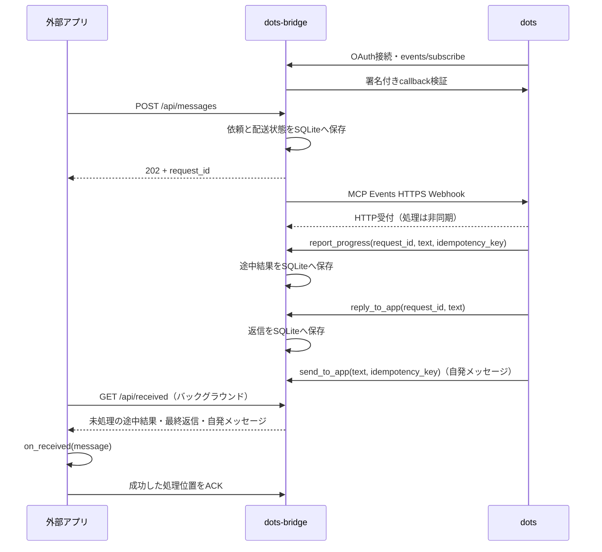

# dots-bridge

外部アプリとOpenAIのdotsを、HTTPとMCP Eventsで双方向につなぐPythonパッケージです。
パッケージ名は`dots-bridge`、import名は`dots_bridge`です。Python 3.11以降に対応します。



dotsへの配信はHTTPS POST、外部アプリの受信はバックグラウンドのHTTPポーリングです。
OpenAI互換コネクターを別プロセスで起動すると、利用側からChat Completions形式のREST APIとResponses形式のWebSocketでも呼び出せます。
`@bridge.on_received`で受信時の処理を登録でき、送信と受信を独立して動かせます。
`ask()`で送信した依頼の返信を待つこともできます。
OpenAI APIキーは不要です。dots側でMCPサーバーへOAuth接続し、外部アプリからdotsへ送る場合はイベントも購読します。

## インストール

このリポジトリーからインストールできます。

```sh
python -m venv .venv
source .venv/bin/activate
python -m pip install -e .
```

wheelも作成できます。PyPIへの公開は別途行う作業です。

```sh
python -m pip install build
python -m build
python -m pip install dist/dots_bridge-0.5.0-py3-none-any.whl
```

## サーバーの起動

```sh
dots-bridge init --config bridge.toml --public-url https://YOUR-DOMAIN.ngrok.app
dots-bridge serve --config bridge.toml
```

別ターミナルで公開URLをローカルの8765番ポートへ転送します。ngrok以外のHTTPSリバースプロキシも利用できます。

```sh
ngrok http 8765 --url https://YOUR-DOMAIN.ngrok.app
```

`init`は設定ファイルを権限0600で新規作成し、既存ファイルを上書きしません。
`bridge.toml`には独立した`owner_key`、`api_key`、`storage_key`を生成します。
このファイルはGitの管理対象から除外してあります。

| 設定 | 用途 |
| --- | --- |
| `public_base_url` | 外部から到達できるHTTPS origin。パスは含めない |
| `redirect_uri` | プラグイン登録画面に表示されるOAuth callback URL。初回は空欄でよい |
| `client_id` | 固定OAuthクライアントID。初期値は`dots-bridge` |
| `owner_user_id` | 接続確認ツールが返す所有者ID。初期値は`owner` |
| `owner_key` | OAuthの同意画面で所有者が入力するキー |
| `api_key` | 外部アプリから`/api/*`を呼ぶBearerキー |
| `storage_key` | 保存したcallback URLとWebhook secretを暗号化するキー |
| `db_path` | SQLiteファイル。設定ファイルからの相対パス。初期値は`data/bridge.sqlite3` |
| `host` / `port` | 待受先。初期値は`127.0.0.1:8765` |
| `subscription_ttl_seconds` | 購読の上限・既定寿命。初期値86400秒 |
| `reply_timeout_seconds` | 依頼を作成してから途中結果・最終返信を受け付ける期間。初期値3600秒 |
| `max_delivery_attempts` | Webhook配送の最大試行回数。初期値5回 |
| `retry_base_seconds` | 指数バックオフの基準秒数。初期値1秒 |
| `worker_interval_seconds` | 配送キュー確認の最大待ち間隔。初期値0.5秒 |

`DOTS_BRIDGE_OWNER_KEY`、`DOTS_BRIDGE_API_KEY`、`DOTS_BRIDGE_STORAGE_KEY`で各キーを環境変数から上書きできます。
`.env`の自動読み込みは行いません。設定変更後はサーバーを再起動してください。
同じDBを継続利用する間は`storage_key`を保管してください。暗号鍵が異なるDBは起動時に拒否します。

## dotsを接続する

1. サーバーとHTTPS公開先を起動し、[プラグイン画面](https://chatgpt.com/plugins)でカスタムMCPサーバーを追加します。
2. MCP URLを`https://YOUR-DOMAIN.ngrok.app/mcp`、認証をOAuthにします。
3. 登録画面に表示された**正確な**callback URLを、`bridge.toml`の`redirect_uri`に設定してサーバーを再起動します。
4. 下表の値で登録・接続し、同意画面には`owner_key`を入力します。
5. 公開一覧に`app.message.created`、`get_current_user`、`get_message`、`report_progress`、`reply_to_app`、`send_to_app`が表示されることを確認します。変更後はツール・イベントを再スキャンします。

| 登録項目 | 値 |
| --- | --- |
| クライアント登録方式 | ユーザー定義・事前登録のOAuthクライアント |
| クライアントID | `dots-bridge`（設定の`client_id`と一致させる） |
| クライアントシークレット | 空欄 |
| トークンエンドポイント認証方式 | `none` |
| 既定スコープ | `events:read messages:reply` |
| 認可URL | `https://YOUR-DOMAIN.ngrok.app/authorize` |
| トークンURL | `https://YOUR-DOMAIN.ngrok.app/token` |
| 認可サーバーベースURL | `https://YOUR-DOMAIN.ngrok.app` |
| リソース識別子 | `https://YOUR-DOMAIN.ngrok.app/mcp` |
| DCR・CIMD・OIDC | 使用しない |

`owner_key`をOAuthのクライアントシークレットに設定しないでください。
callback URLとWebhook secretは、購読時にdots側からサーバーへ渡されます。
公開用のngrok URLをイベントの配信先として手動登録する必要はありません。

接続後、イベントを受信させたいdotsで、例えば次のように依頼します。

> dots-bridgeのget_current_userで接続を確認してください。
> app.message.createdをchannel="default"で購読してください。
> この接続は私のアプリです。届いたdata.textを私からの依頼として処理し、
> 途中結果を伝える場合は、同じdata.request_idと通常の文章を使ってreport_progressを呼んでください。
> idempotency_keyは途中結果ごとに一意にし、同じ途中結果の再試行では同じ値を使ってください。
> 最終回答は必ずdata.request_idと回答本文を使ってreply_to_appへ返してください。
> 通常確認が必要な操作は、この経路でも確認してください。
> 購読できたか、その結果も教えてください。

dotsから依頼に紐づかないメッセージも送ってほしい場合は、その用途もdotsに伝えます。

> 私が依頼した通知をアプリへ届ける場合は、send_to_appをchannel="default"で呼んでください。
> idempotency_keyには通知ごとに一意な値を使い、同じ通知を再試行する場合は同じ値を使ってください。

| ツール | 用途 |
| --- | --- |
| `report_progress(request_id, text, idempotency_key)` | 依頼に紐づく途中結果。依頼は未完了のまま |
| `reply_to_app(request_id, text)` | 依頼の最終回答。依頼ごとに1件 |
| `send_to_app(text, idempotency_key, ...)` | 依頼に紐づかない自発メッセージ |

MCPツールの呼び出し引数はJSONですが、`text`本文は普通の文字列です。
dotsに構造化JSONの回答本文を作らせる必要はありません。途中結果も最終回答も、そのままの文章を渡します。
`send_to_app`は先行する依頼やイベント購読を必要としません。OAuth接続と`messages:reply`権限が必要です。
dots側の画面や会話の文章が自動転送されるわけではなく、これらのツールを呼んだ内容がアプリへ届きます。

既存の接続で途中結果に対応する場合は、更新後のbridgeとコネクターを両方再起動し、MCPツールを再スキャンしてください。
そのうえで、上の`report_progress`を含む指示をdotsへ伝え直します。

プラグインの接続とイベント購読は別の手順です。購読は`subscriptions`で確認できます。

```sh
dots-bridge subscriptions --config bridge.toml
dots-bridge send "接続テストです。受信したと返信してください。" --wait --timeout 120 --config bridge.toml
```

用途を分ける場合は、異なる`channel`で購読し、送信時にも対応するchannelを指定してください。
同じchannelに複数の購読がある場合は、送信時の`subscription_id`を必須にしています。
購読を解除するには、対象dotsに`app.message.created`の購読解除を依頼します。

## ターミナルでチャットする

サーバーとngrokを起動したまま、チャット用のサンプルを実行できます。

```sh
python -m pip install -e '.[chat]'
python examples/chat.py
```

```text
user> こんにちは
dots> こんにちは！何かお手伝いできることはありますか？
user> 今日の予定を一緒に考えよう
dots> もちろんです。今日は何をする予定ですか？
user>
```

Enterで送信し、何度でもやり取りできます。入力中も`on_received`で途中結果・最終返信・自発メッセージを受け取り、
`dots>`に表示します。返信を待たず次の入力を始めても、入力中の文字を保ってプロンプトを描き直します。
`/exit`、`/quit`、Ctrl+C、Ctrl+Dで終了します。サーバーとngrokはそのまま継続します。

設定ファイルの既定値はリポジトリー直下の`bridge.toml`なので、ほかのディレクトリーからも実行できます。

```sh
python /Users/uezo/dev/dots-bridge/examples/chat.py
```

別のchannelやサーバーを使う場合は、引数で指定できます。

```sh
python examples/chat.py --channel work --consumer-id chat-work
python examples/chat.py --url http://127.0.0.1:9000 --config /path/to/bridge.toml
```

同じchannelに複数の購読がある場合は、`--subscription-id`で送信先を選びます。
既定consumer IDは`example-app`で、`send_message.py`と共通です。
一方を終了してからもう一方を起動すると、同じ処理位置を引き継ぎ、処理済みの受信は再表示しません。
両方を同時に動かす場合は、チャットの`--consumer-id`に別のIDを指定してください。
受信の処理位置はIDごとに独立しているため、新しいIDでは保存済みの受信も先頭から表示します。
channelを変更する場合も別のconsumer IDを指定してください。
このサンプルの端末入力には[prompt_toolkit](https://python-prompt-toolkit.readthedocs.io/en/master/pages/asking_for_input.html#prompt-in-an-asyncio-application)を使用しています。

## 受信時にコールバックを実行する

別プロセスのアプリでは`AsyncBridgeClient`にハンドラーを登録し、`start_receiving()`で受信を開始します。
`send_message()`はサーバーに依頼を保存したあとに戻ります。返信を待たずにアプリの処理を続けられます。

```python
import asyncio
from dots_bridge import AsyncBridgeClient, ReceivedMessage, Settings


async def main():
    settings = Settings.from_file("bridge.toml")
    async with AsyncBridgeClient("http://127.0.0.1:8765", api_key=settings.api_key) as bridge:

        @bridge.on_received
        async def received(message: ReceivedMessage):
            # ここで表示、音声再生、アプリの状態更新などを行います。
            print(message.kind, message.request_id, message.text)

        await bridge.start_receiving(consumer_id="my-app", channel="default")
        queued = await bridge.send_message("こんにちは。短く返信してください。")
        print("queued:", queued["request_id"])
        # ここからアプリのほかの処理を実行できます。
        await asyncio.Event().wait()  # このサンプルはCtrl+Cまで受信を続けます。


asyncio.run(main())
```

実行可能なサンプルは[examples/send_message.py](examples/send_message.py)です。
コンテキストを抜けると受信タスクも停止します。手動では`await bridge.stop_receiving()`で停止できます。
同期の`def`ハンドラーも登録でき、その場合はイベントループを止めないよう別スレッドで実行します。

受け取る`ReceivedMessage`は次の属性を持ちます。

| 属性 | 内容 |
| --- | --- |
| `text` | dotsからの本文 |
| `kind` | 途中結果なら`progress`、最終返信なら`reply`、自発メッセージなら`push` |
| `request_id` | 途中結果・最終返信の依頼ID。自発メッセージなら`None` |
| `channel` | 受信先のchannel |
| `metadata` | 途中結果・最終返信なら元の依頼のmetadata、自発メッセージならツールで指定したmetadata |
| `id` | 受信メッセージの一意なID。再処理時も同じ値 |
| `sequence` | 保存順に増加する受信番号 |
| `received_at` | サーバーの受信日時（UTCのISO 8601） |

登録順にハンドラーを実行し、全ハンドラーが成功してから処理位置をSQLiteへ保存します。
ハンドラー失敗・通信の一時エラーはバックオフして再試行し、未処理の受信を飛ばしません。
処理成功後のACKが失敗した場合などは同じ受信を再実行し得るため、外部への副作用は`message.id`で重複を防いでください。
同期ハンドラーの実行中に受信を停止しても、既に動いている同期関数は中断しません。

同じ`consumer_id`で再起動すると、保存した処理位置から再開します。
新しいconsumerは保存済みの受信を先頭から処理します。既存DBの返信も初回のDB更新時に受信一覧へ移します。
複数アプリへ配信する場合はそれぞれ別の`consumer_id`を使ってください。
同じconsumerを複数プロセスで同時に動かさないでください。channelを変更する場合も別のconsumer IDを使います。
`channel`を省略すると全channelを受信します。

認証失敗など継続できないエラーでは受信を停止し、`bridge.receiving`が`False`、
`bridge.receiver_error`がエラーになります。原因を解消して`start_receiving()`を再度呼ぶと再開できます。
通信やハンドラーの一時的なエラーは受信タスク内で再試行します。

同じサーバープロセスで処理する場合は、`DotsBridge`にも同じデコレーターを使えます。

```python
from dots_bridge import DotsBridge, ReceivedMessage, Settings, create_app

settings = Settings.from_file("bridge.toml")
bridge = DotsBridge(settings)


@bridge.on_received
async def received(message: ReceivedMessage):
    print(message.kind, message.text)


app = create_app(settings, bridge=bridge)
```

アプリのlifespan開始時に受信も開始し、終了時に停止します。
この場合の既定consumer IDは`in-process`です。実行例は[examples/embedded.py](examples/embedded.py)です。

## 送信した依頼の返信を待つ

外部アプリには`api_key`だけを渡します。サーバーと同じ設定ファイルを読む場合の例です。
`ask()`と`wait_for_reply()`は途中結果を返さず、`reply_to_app`による最終回答を待ちます。

```python
from dots_bridge import BridgeClient, ReplyTimeoutError, Settings

settings = Settings.from_file("bridge.toml")
with BridgeClient("http://127.0.0.1:8765", api_key=settings.api_key) as client:
    print(client.list_subscriptions())
    try:
        answer = client.ask("こんにちは。短く返信してください。", timeout=120)
        print(answer)
    except ReplyTimeoutError as exc:
        # 同じ依頼の返信待ちを再開できます。再送は不要です。
        print("待機期限になりました。request_id:", exc.request_id)
```

送信と待機を分けると、アプリが処理を続けている間に返信を取得できます。

```python
import asyncio
from dots_bridge import AsyncBridgeClient, Settings


async def main():
    settings = Settings.from_file("bridge.toml")
    async with AsyncBridgeClient("http://127.0.0.1:8765", api_key=settings.api_key) as client:
        message = await client.send_message(
            "この依頼への回答を返してください。",
            channel="default",
            metadata={"source": "my-app"},
            idempotency_key="my-app-request-001",
        )
        result = await client.wait_for_reply(message["request_id"], timeout=120)
        print(result["reply"])


asyncio.run(main())
```

同じ`idempotency_key`と同じ入力による送信は、保存済みの依頼を返します。
同じキーで入力を変更すると409エラーになります。入力には送信先、channel、metadataも含まれます。
タイムアウト後も依頼と返信はDBに残り、`get_message(request_id)`で確認できます。
クライアントの待機期限と、サーバーの`reply_timeout_seconds`は別の期限です。
同期版はHTTPXの通信操作ごとのタイムアウトを併用します。通信中も含む厳密な待機時間制限が必要なら非同期版を利用してください。

## 依頼の途中結果と最終回答を順に受け取る

`report_progress`による途中結果は、同じ`request_id`に何件でも保存できます。
途中結果ごとの`idempotency_key`は1〜128文字です。同じ依頼・キー・本文で再試行すると同じ受信を返し、本文を変えると409になります。
最終回答の保存後は新しい途中結果を受け付けませんが、保存済み途中結果の同文再試行は成功します。

`AsyncBridgeClient.iter_responses()`で途中結果から最終回答まで順に受け取れます。
上の非同期クライアントのコンテキスト内で、次のように呼び出します。

```python
queued = await client.send_message("調査中の状況も知らせて、最後に結論を返してください。")
async for message in client.iter_responses(queued["request_id"], timeout=120):
    print(message.kind, message.text)
```

保存済みの途中結果も保存順に返し、`kind="reply"`で終了します。
`timeout`は反復全体の固定期限で、途中結果が届いても延長しません。
依頼の再送やconsumerのACKは行わず、`on_received`とも併用できます。
一覧を自分で取得する場合は、同期・非同期クライアントの`list_response_messages(request_id, after=0, limit=100)`を使います。
`after`に最後の`sequence`を指定すると、その続きから取得できます。

## OpenAI互換コネクター

`dots-bridge serve`はbridge本体を起動します。
`dots-bridge connector openai`は既存bridgeへHTTP接続するコネクターだけを別プロセスで起動します。
コネクター用のルートをMCPサーバーへ追加したり、別DBを用意したりする必要はありません。
bridgeとngrokを動かした状態で、別ターミナルで起動します。

```sh
dots-bridge connector openai
```

`--config`を省略すると、カレントディレクトリーの`bridge.toml`を読みます。
既定の待受は`127.0.0.1:8766`で、1つのコネクターが同じポートでChat CompletionsのREST/SSEとResponsesのWebSocketを提供します。
利用側は`bridge.toml`の`api_key`でBearer認証します。
このキーはbridgeへの呼び出しにも使われ、OpenAIのAPIキーではありません。
接続先bridgeのURLは設定の`host` / `port`から求めます。別ホストの場合は`--url`で指定します。

```sh
dots-bridge connector openai --config /path/to/bridge.toml \
  --url http://127.0.0.1:8765 --host 127.0.0.1 --port 8766 \
  --channel default --reply-timeout 600
```

同じbridge channelに複数のsubscriptionがある場合は`--subscription-id`も指定してください。
`--reply-timeout`の既定は600秒です。調査などで最終回答まで数分かかる場合も待機します。
呼び出し側のタイムアウトは`--reply-timeout`より長く設定してください。
CLI起動時は`dots_bridge.connectors.openai`のINFOログに依頼の受付、途中結果、最終回答を記録し、エラーはWARNINGで記録します。
`request_id`で同じ依頼を追跡でき、`elapsed`は処理の経過秒数、`reply_timeout`は設定した待機秒数です。本文・認証情報・接続先URLは記録しません。

```text
event=request_error protocol=chat.completions.stream request_id=req_... code=bridge_reply_timeout elapsed=600.006s reply_timeout=600.000s error_type=ReplyTimeoutError
```

`bridge_reply_timeout`は最終返信の待機期限に達したことを示します。上流との通信障害は`bridge_unavailable`となり、`error_type=ReadTimeout`などで通信側のタイムアウトを判別できます。
タイムアウトでもdotsへ送信済みの依頼は継続するため、再送前に`request_id`で状態を確認してください。

コネクターには追加DBが不要です。途中結果・最終返信は`request_id`で照合し、受信カーソルを進めません。
自発pushを購読する場合だけ専用の`consumer_id`を指定します。既存の`on_received`とは処理位置を分けて併用できます。

| 入口 | 対応内容 |
| --- | --- |
| `POST /v1/chat/completions` | JSONは最終回答のみ、`stream: true`のSSEは途中結果と最終回答 |
| `GET /v1/models` | モデル名`dots`を返す一覧 |
| `WS /v1/responses` | Responses形式の要求・返信と、明示的に購読した自発push |
| `GET /health` | コネクター自身の生存確認。bridgeへの接続確認ではない |

### Chat Completionsから呼び出す

公式Python SDKを利用する場合は、呼び出し側の環境にインストールします。

```sh
python -m pip install 'openai[realtime]>=3.8,<4'
```

```python
from openai import OpenAI
from dots_bridge import Settings

settings = Settings.from_file("bridge.toml")
with OpenAI(
    base_url="http://127.0.0.1:8766/v1",
    api_key=settings.api_key,
    timeout=660,
    max_retries=0,
) as client:
    result = client.chat.completions.create(
        model="dots",
        messages=[
            {"role": "user", "content": "以前の依頼"},
            {"role": "assistant", "content": "以前の応答"},
            {"role": "user", "content": "この依頼だけをdotsに送ってください"},
        ],
    )
    print(result.choices[0].message.content)
```

`stream=False`の通常REST応答は最終回答だけを返します。
`stream=True`では、最初にassistant role、続いて届いた途中結果と最終回答をそれぞれcontent chunkで返します。
途中結果の本文末尾には`\n\n`を加えて区切り、`finish_reason: "stop"`は最終回答の後だけ、`[DONE]`は最後に送ります。
これはツールへ渡された文章単位の配信で、dotsの生成トークンを逐次取得するものではありません。
待機中はSSEのコメントを送り、トークン数・料金は取得できないためusageを推定しません。

各content chunkには、dots-bridge独自の`dots_bridge`属性も付きます。
`kind`で途中結果と最終回答を区別し、`message_id`と`sequence`で受信を識別できます。

```json
{
  "dots_bridge": {
    "kind": "progress",
    "request_id": "req_...",
    "message_id": "received-message-id",
    "sequence": 123
  }
}
```

### ResponsesのWebSocketから呼び出す

同じSDKクライアントで、次のように接続できます。

```python
with client.responses.connect(max_retries=0) as connection:
    connection.response.create(
        model="dots",
        input="今度はこちらの依頼をお願いします",
        # previous_response_idは省略しても、指定しても構いません。
    )
    for event in connection:
        if event.type == "response.output_text.delta":
            print(event.delta, end="", flush=True)
        elif event.type == "response.completed":
            print()
            break
        elif event.type in {"error", "response.failed", "response.incomplete"}:
            raise RuntimeError(event.to_json())
```

このブロックは上の`with OpenAI(...) as client:`の内側で実行してください。
同じWebSocketを維持したまま`response.create`を繰り返して会話できます。
生のWebSocketでは`ws://127.0.0.1:8766/v1/responses`へBearerヘッダー付きで接続し、次のJSONを送信します。

```json
{"type":"response.create","model":"dots","input":"こんにちは"}
```

`response.created`、`response.in_progress`の後、途中結果・最終回答が届くたびに標準のmessage/content/textイベントを返します。
1回の依頼は同じresponse IDを使い、各文章を別のoutput itemとして追加します。
途中結果のitemは`phase="commentary"`、最終回答のitemは`phase="final_answer"`です。
途中結果の`response.output_item.done`はそのitemの完了であり、依頼全体は完了しません。
最終回答の後にだけ`response.completed`を1回返し、その`response.output`に途中結果と最終回答の全itemを含めます。
失敗時の`response.failed`も、それまでに届いた途中結果を`response.output`へ保持します。

上の受信例は途中結果も表示します。最終回答だけ必要な場合は、完了応答の`response.output`から
`item.phase == "final_answer"`のmessageだけを選び、そのcontentを使ってください。
途中結果の受信に`dots.subscribe`は不要です。
`stream_id`を指定すると各イベントに同じ値を返しますが、処理は1接続内でFIFOです。
異なるWebSocket接続とHTTPリクエストは並行して利用できます。

対話チャットのサンプルがあります。`dots-bridge connector openai`を起動したまま、別ターミナルで実行します。

```sh
python -m pip install 'openai[realtime]>=3.8,<4' 'prompt-toolkit>=3.0.43,<4'
python examples/openai_client.py --mode chat
python examples/openai_client.py --mode stream
python examples/openai_client.py --mode websocket
```

どのmodeも`user>`で入力してEnterで送信し、返信を`dots>`に表示します。
`stream`と`websocket`では途中結果を`progress>`に表示します。
`/exit`、`/quit`、Ctrl+C、Ctrl+Dで終了します。
`prompt-toolkit`は既存の`.[chat]` extraでインストールしても構いません。
各要求では最新の入力1件だけを送り、過去の履歴を積み直しません。会話の文脈はdots側で保持します。

エラー時は原因コード、メッセージ、要求ID、経過秒を表示します。
SSEの途中で失敗した場合も`bridge_reply_timeout`などの原因を確認できます。
コネクターの返信待ちは既定600秒で、途中結果が届いても延長しません。
このサンプルのクライアント側タイムアウトは既定660秒です。
待機時間を変更する場合はコネクターを再起動し、クライアント側の`--timeout`もそれより長く指定します。
既定値を明示する場合は、以下をそれぞれ別ターミナルで実行します。

```sh
dots-bridge connector openai --reply-timeout 600
python examples/openai_client.py --mode stream --timeout 660
```

`--timeout`はSDKの通信タイムアウトで、WebSocketでは1要求全体の待機時間も制限します。
待機期限を超えても送信済みの依頼は取り消されず、自動再送もしません。

最初の文章を引数で渡すと、自動送信後も対話を続けます。

```sh
python examples/openai_client.py --mode stream "こんにちは"
```

WSモードは同じ接続で何度でも会話でき、待機中・入力中の自発pushも`push>`に表示してからACKします。
SDKの`recv_bytes()`を単一の受信ループで読み、Responsesイベントと独自の`dots.*`イベントを振り分けます。
pushの処理位置には`--consumer-id`を使い、既定値は`example-openai`です。
同じIDの別接続を同時に動かさず、別の受信先として使う場合はIDを変更してください。
このサンプルのACKは表示完了を表します。実際のアプリでは必要な取り込みが成功してからACKしてください。

### WebSocketで自発pushも受信する

自発pushは`dots.push`イベントで通知します。途中結果・最終返信の`response.*`系列とは別で、返信を待っている間にも受信できます。
**`type: "dots.push"`と`message.kind: "push"`で識別し、`message.request_id`は`null`になります。**
`message.id`は受信メッセージ自身のIDで、再配信時も変わりません。

WebSocket接続後、次のJSONで購読を開始してください。`response.create`を送らなくてもpushを受信できます。

```json
{"type":"dots.subscribe","consumer_id":"personal-agent"}
```

購読成功時は`dots.subscribed`が返り、その後からpushが届きます。

```json
{
  "type": "dots.push",
  "consumer_id": "personal-agent",
  "message": {
    "id": "received-message-id",
    "sequence": 123,
    "kind": "push",
    "request_id": null,
    "channel": "default",
    "text": "依頼されていた件について、新しい情報がありました。",
    "metadata": {},
    "received_at": "2026-10-22T03:00:00Z"
  }
}
```

パーソナルエージェントの共通文脈への取り込みなど、必要な処理が成功してからACKを返します。

```json
{"type":"dots.push.ack","message_id":"received-message-id"}
```

bridgeに処理済み位置を保存できると`dots.push.acked`を返し、次のpushへ進みます。
一度に未ACKのpushは1件だけです。ACKが失敗した場合は`error`が返り、同じ`message_id`で再ACKできます。
直前に成功したACKの再送は、同じ接続内では処理済み確認として扱います。

| イベント | 向き | 内容 |
| --- | --- | --- |
| `dots.subscribe` | 利用側→コネクター | `consumer_id`を指定してpushを購読 |
| `dots.subscribed` | コネクター→利用側 | 購読したconsumer、channel、現在のcursor |
| `dots.push` | コネクター→利用側 | 自発メッセージ。`message`は既存の`ReceivedMessage`と同じ形式 |
| `dots.push.ack` | 利用側→コネクター | 処理したpushの`message_id`を指定 |
| `dots.push.acked` | コネクター→利用側 | 保存できた`message_id`と`sequence`を確認 |

この`dots.*`系列は**dots-bridge独自の拡張**です。購読しない接続には送らないため、従来のResponsesクライアントもそのまま使えます。
pushを扱う場合は、下のサンプルのように生のWebSocketでJSONを読む方法を推奨します。
公式SDKで扱う場合も、`recv_bytes()`からJSONを読み、独自イベントを処理してください。標準イベントの型への変換は`response.*`等だけに行い、同じsocketで複数の受信ループを動かさないでください。

```sh
python examples/websocket_push.py --consumer-id personal-agent
# 同じsocketで依頼の返信とpushを受け取る場合
python examples/websocket_push.py --consumer-id personal-agent --message "こんにちは"
```

サンプルは表示後にACKし、接続を維持します。実際のアプリでは、永続的な取り込みが成功してからACKしてください。
切断後は同じ`consumer_id`で接続・購読し直すと未ACK分を再配信します。処理後にACKが届かず切断した場合は再配信され得るので、外部への副作用は`message.id`で重複を防ぎます。

`consumer_id`はLINE・電話などの会話チャネルごとではなく、受信するパーソナルエージェントに対して固定してください。
別のIDで購読すると保存済みのpushを先頭から別途受信します。英数字と`_ . : -`の1〜118文字が使え、bridge内部のconsumerは`openai-ws:<consumer_id>`です。
channelはコネクター起動時の`--channel`に固定されます。同じconsumerでchannelを変更しないでください。
同じコネクタープロセス内では、同じconsumerの同時購読は409で拒否します。別プロセスのコネクター同士でも同じconsumerを同時に使わないでください。
このpush専用consumerでは、依頼に紐づく`progress`・`reply`を読み飛ばしてACKします。
他のconsumerの処理位置には影響しません。

### 互換範囲

- テキスト会話の入出力に対応します。Chatの`messages`、Responsesの配列形式`input`では、**最新の`role: user`の1件だけ**を転送します。文字列の`input`はそのまま転送します。
- 過去の履歴、system/developerメッセージ、`instructions`、`previous_response_id`、入力側の`response_id`は転送・復元しません。会話の文脈はdots側で継続します。
- `model`は互換クライアント用の名前です。別名でも同じdotsへ届き、モデルを切り替えません。temperatureやトークン上限などの生成設定は無視します。
- 画像・音声・ファイル、クライアント指定のtools、構造化出力、複数候補、warmup、steering、ResponsesのHTTP APIや保存済み応答の取得は未対応です。最新のメッセージが非テキストや空の場合はエラーにし、古い依頼を代わりに送信しません。
- WebSocketは`response.create`に対する返信に加え、独自の`dots.subscribe`による自発push購読に対応します。pushはResponsesの完了イベントに混ぜず、利用側からの明示ACKで処理済みにします。
- 通常RESTは最終回答のみ、SSEとResponses WebSocketは途中結果も返します。途中結果は完了扱いにせず、最終回答で依頼を閉じます。
- 接続が切れたり待機がタイムアウトしても、送信済みのdotsへの依頼は継続します。HTTP応答の`X-Dots-Request-ID`、エラー内の`request_id`、WS完了・失敗応答の`metadata.dots_bridge_request_id`で状態を調べられます。
- コネクターは依頼を自動再送しません。HTTPエラーでは公式SDK向けに`x-should-retry: false`を返します。切断後も再送を避けたい場合は呼び出し側で自動再試行を無効にし、HTTPでは同じ`Idempotency-Key`ヘッダーを付けて再実行できます（128文字以内）。
- 入力全体は300 KiB、転送する最新のテキストは16,000文字までです。WSは処理中の1件に加え16件まで待機できます。ブラウザーからの異なるoriginへのアクセスは許可しません。

Pythonアプリから直接起動する場合は、`dots_bridge.connectors.create_openai_connector(bridge_url, api_key=...)`がStarletteアプリを返します。
コネクターを提供するためのOpenAI SDKやOpenAI APIキーは不要です。
プロトコルは公式の[Chat Completionsストリーミング仕様](https://developers.openai.com/api/reference/resources/chat/subresources/completions/streaming-events)と[Responses WebSocket仕様](https://developers.openai.com/api/docs/guides/websocket-mode)を参照しています。

## HTTP API

`/api/*`には`Authorization: Bearer <api_key>`が必要です。JSONのみ受け付けます。

| メソッド・パス | 内容 |
| --- | --- |
| `GET /health` | 認証不要のプロセス稼働確認 |
| `GET /api/subscriptions` | 有効な購読のID、channel、期限。callbackやsecretは返さない |
| `POST /api/messages` | 依頼を保存して202を返す |
| `GET /api/messages/{request_id}` | 配送状態と保存済みの最終返信を取得 |
| `GET /api/messages/{request_id}/responses?after=0&limit=100` | その依頼の途中結果・最終返信を保存順で取得 |
| `DELETE /api/subscriptions/{subscription_id}` | 購読を解除し、未配送依頼をキャンセル |
| `GET /api/received?after=0&limit=100&channel=default` | 途中結果・最終返信・自発メッセージの受信一覧（channelは省略可能） |
| `GET /api/consumers/{consumer_id}?channel=default` | consumerの処理位置を取得・初期化 |
| `POST /api/consumers/{consumer_id}/ack` | `{"sequence": 123, "channel": "default"}`で処理位置を進める |

受信一覧・依頼ごとの応答一覧の戻り値は`{"messages": [...]}`、consumer操作の戻り値は`{"cursor": 123}`です。
`after`は指定番号よりあとの受信、`limit`は1〜100件です。
依頼ごとの応答一覧は`progress`・`reply`だけを返し、依頼が存在しない場合は404です。
通常はクライアントのバックグラウンド受信が一覧取得とACKを行います。
手動で扱う場合は同期・非同期クライアントの`list_received()`、`get_consumer_cursor()`、`acknowledge_received()`を使えます。
受信一覧の取得だけでは処理位置は進みません。
依頼ごとの一覧取得には同期・非同期クライアントの`list_response_messages()`、最終回答までの逐次受信には非同期クライアントの`iter_responses()`も使えます。

送信JSONは次の形です。`text`以外は省略可能です。

```json
{
  "text": "こんにちは",
  "channel": "default",
  "subscription_id": "sub_...",
  "metadata": {"source": "my-app"},
  "idempotency_key": "my-request-001"
}
```

戻り値には`request_id`、`event_id`、`delivery_status`、`reply_status`、`reply`などが含まれます。

| フィールド | 値・意味 |
| --- | --- |
| `delivery_status` | `queued` / `delivering` / `accepted` / `failed` / `cancelled` |
| `reply_status` | `pending` / `replied` / `expired` / `cancelled` |
| `reply` | 保存済みの最終返信。未返信時は`null` |
| `attempts` | Webhookの試行回数 |
| `status_code` | 最後に得たWebhookのHTTPステータス |
| `error` | 秘密情報を含まないエラーコード。成功時は`null` |

**202は保存完了、`accepted`はdots側WebhookのHTTP受付を表します。**
dotsの処理完了・回答生成を示すのは`reply_to_app`で返信が保存され、`reply_status`が`replied`になった段階です。
`report_progress`を呼んでも`reply_status`は`pending`のままです。

## 既存ASGIアプリへの組み込み

FastAPIは必須依存にしていません。StarletteのASGIアプリとして起動・組み込みできます。

```python
from dots_bridge import Settings, create_app

app = create_app(Settings.from_file("bridge.toml"))
```

```sh
uvicorn main:app --host 127.0.0.1 --port 8765 --workers 1 --no-access-log
```

ライフサイクルの開始で配送workerが動き、終了で停止します。
他のASGIアプリへmountする場合は、このアプリのlifespanも呼び出してください。
OAuthのwell-knownと運用エンドポイントを公開originのルートから利用できるようにする必要があります。
最初は独立したサーバーとして動かす構成を推奨します。

## 保存・再送・運用上の範囲

- **単一所有者向けです。** 複数テナント・一般公開の本人確認基盤は提供しません。
- 設定はTOML、購読、依頼、配送状態、途中結果・最終返信・自発メッセージ、受信処理位置、OAuth状態はSQLiteに保存します。
  OAuthアクセストークンは1時間、refresh tokenは30日です。再起動で接続状態を失いません。
- 既存dots-bridgeのschema 1〜3は、次回bridge起動時に同一トランザクションでschema 4へ自動移行します。
  保存済みの受信ID・sequence・consumerの処理位置を維持します。コネクターはDBを直接操作しません。
- Webhookのcallback URLとsecretはFernetで暗号化します。本文・返信・metadataを含むDB全体の暗号化は行いません。
  DB・設定・バックアップは所有者のみ読める場所に置いてください。
- callbackを署名付きチャレンジで検証し、Standard Webhooksで署名します。
  HTTPS・公開IPのみ許可し、DNSで検証したIPへ固定接続します。redirect・環境proxyは使いません。
- ネットワーク障害、408、425、429、5xxは回数制限付きで再試行します。410・413などの恒久エラーは再試行しません。
  410では購読を削除します。同じイベントIDと本文を維持し、試行ごとに署名を作り直します。
- サーバー停止後の未配送は起動時に再開します。送信中に停止した場合は30秒のlease期限後に再開します。
  受付後に通信が切れた場合は重複配信し得ます。dots側の副作用にも冪等性を持たせてください。
- 最終返信は依頼ごとに1つです。同じ本文の再呼び出しは成功し、違う本文の再返信は拒否します。
  途中結果は`report_progress`で複数回保存でき、SSE/WSやアプリの受信処理へ順に渡します。
  dotsの生成トークンの逐次取得や、会話ログの自動取得は提供しません。
- 有効な購読に対して送信します。送信時に購読がなければ409です。
  解除・失効・明示的なOAuth取消後は未配送を止めます。既に開始したHTTP要求は取り消せません。
- イベント履歴のMCP cursor replayは提供せず、`cursor: null`を返します。
  内部outboxの再送と、MCPの履歴再生は別の機能です。`ttlMs: null`でも有限の購読期限を返します。
- このパッケージが保存するのは`report_progress`・`reply_to_app`・`send_to_app`へ渡された本文です。
  dotsがツールを必ず呼ぶこと、即時に処理されることは保証できません。
  dotsへの依頼で返信・通知方法を明示してください。
- 受信一覧とconsumerの処理位置は`prune`で削除しません。依頼を削除しても未処理の途中結果・最終返信を受信一覧から取得できます。
  長期運用時はDB容量も確認してください。

明示的にOAuth接続と購読を全て取り消す場合:

```sh
dots-bridge revoke --config bridge.toml
```

古い完了済みメッセージを削除する場合:

```sh
dots-bridge prune --days 30 --config bridge.toml
```

## 開発・検証

```sh
python -m pip install -e '.[dev]'
pytest
ruff check .
ruff format --check .
python -m build
```

テストは一時SQLiteと偽callbackを使い、実際のdotsや本番の秘密情報へ接続しません。
OAuthの認可・更新・取消、実際のFastMCP HTTP経由の発見とツール呼び出し、
署名・SSRF対策、再送、再起動、依頼と返信の相関を検証します。

実際のdotsとの動作確認は別途、接続→購読→アプリ送信→dots処理→返信取得→解除を一通り行ってください。
本リポジトリーの自動テストだけでは、対象アカウントの機能可否や長期的なdots側の自動更新までは確認できません。

## 実装と参照元

MCP 2.0（`2026-07-28`）、HTTP transport、ツールのスキーマ・呼び出し、OAuthの標準エンドポイントは
FastMCP 4.1以降とMCP Python SDKに任せています。
このパッケージではdraft Eventsの3メソッドをFastMCPの`ServerExtension`で追加しています。
現在のSDKが`capabilities.events`を落とす問題と、OpenAIのツール認証メタデータの互換処理は、
小さなmiddlewareとして`mcp.py`に分離してあります。

- [OpenAI MCP Events](https://developers.openai.com/plugins/build/mcp-events)
- [OpenAI Authentication](https://developers.openai.com/plugins/build/auth)
- [FastMCP MCP 2.0対応](https://github.com/PrefectHQ/fastmcp/blob/main/dev-docs/v4-notes/protocol-2026.md)
- [FastMCP Extensions](https://github.com/PrefectHQ/fastmcp/blob/main/fastmcp_slim/fastmcp/server/extensions.py)
- [MCP SDKのEvents capabilityに関するissue](https://github.com/modelcontextprotocol/python-sdk/issues/3640)

設計の参照元はAIAvatarKitの`dots_tool/mcp_events`プロトタイプです。
既存プロトタイプのSQLite形式とは互換ではありません。新しいDBで接続・購読し直してください。
