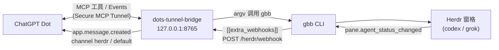

# gbb / Herdr coding-agent integration

[中文](#中文) · [English](#english)

## 中文

可选功能（默认关闭）：让 ChatGPT Dot 通过本 bridge 驱动和监控你 Mac 上由 **gbb** 管理的编码 agent（codex、grok），并把它们的状态变化推送给 Dot。

- **gbb** = [grokbot-bridge-herdr](https://github.com/Phoobobo/grokbot-bridge-herdr)：一个 [Herdr](https://herdr.dev) 插件 + `gbb` 命令行，负责在 Herdr 窗格里启动 / 监控 / 接管 agent（原本给 Grok Bot 用，Dot 通过本 bridge 共用同一套 gbb 和同一套护栏）。
- 实现：`src/dots_bridge/herdr_tools.py`；只有设置 `DOTS_BRIDGE_HERDR_TOOLS=1` 才会注册工具和 webhook 路由，否则 MCP 工具面和 HTTP 路由与上游完全一致。
- 设计取舍见 gbb 仓库的 [ADR 0003](https://github.com/Phoobobo/grokbot-bridge-herdr/blob/main/docs/decisions/0003-dots-bridge-tools-and-extra-webhooks.md)。



### 12 个工具

| 工具 | 类型 | 对应 gbb 命令 |
|---|---|---|
| `gbb_list` | 只读 | `list`：列出托管任务/窗格（用户自己的窗格不会出现） |
| `gbb_status` | 只读 | `status <task\|pane>`：状态、worktree 的 git status/log |
| `gbb_read` | 只读 | `read --lines N [--visible]`：最近终端输出（看阻塞对话框） |
| `gbb_result` | 只读 | `result`：分支、提交、diff stat、未提交文件、resume 命令 |
| `gbb_doctor` | 只读 | `doctor`：gbb/Herdr 版本、插件链接、webhook 配置（只显示主机名） |
| `gbb_wait` | 只读，**最长 120 秒** | `wait --until … --timeout`；超时返回 `ok=false`，再调一次即可 |
| `gbb_launch` | 启动 agent | `launch --repo --kind codex\|grok --task …`；默认新 worktree + 分支 `gbb/<task>`，并**自动在 prompt 末尾追加“只开 draft PR、不 merge、不推默认分支、不 force-push、不执行 `herdr server stop`”** |
| `gbb_send` | 输入 | `send`：给托管 agent 发后续指令/回答 |
| `gbb_keys` | 输入（destructive） | `keys`：按键（`enter`、`esc`、`down`、`y`…，最多 10 个） |
| `gbb_stop` | destructive，幂等 | `stop`：关闭 gbb 自建的工作区；worktree 和分支保留；交接来的窗格只注销不关闭 |
| `gbb_handover` | 归属 | `handover --pane <id> [--note]`：用户明确把某个窗格交给 Dot 时才用 |
| `gbb_reclaim` | 归属 | `reclaim --pane <id>`：把托管窗格还给用户（agent 继续运行） |

### 安全规则

- **只碰托管窗格**：`gbb_send` / `gbb_keys` / `gbb_stop` / `gbb_reclaim` 执行前会再查一次 `gbb list`，不在登记表里的直接拒绝（gbb 自己也会拒绝，双重保护）。
- **用户工作区受保护**：`DOTS_BRIDGE_HERDR_PROTECTED_WORKSPACES`（默认 `wAS,wAT`）里的窗格一律拒绝，除非是用户主动交接（`origin = handover`）的；`gbb_handover` 也拒绝受保护工作区——用户可以在 Herdr 里自己用窗格动作交接。
- **从不执行 `herdr server stop`**（工具里没有，launch 的 policy 也禁止 agent 这样做）。
- **只用 argv 调子进程**：从不经过 shell 字符串；显式 PATH、关闭 stdin、超时、输出上限；task id / 分支 / 窗格 id / 按键都用正则校验，文本去掉控制字符。
- launch 的 policy 只是给 agent 的指令；真正的权限仍取决于该 agent 和 `gh` 的配置。Dot 本身对高风险操作也会要求你在 ChatGPT 里确认。

### 状态推送：`POST /herdr/webhook`

- **只接受本机**（`127.0.0.1` / `::1`），否则 403。
- **token 文件**：`~/.config/dots-bridge/herdr_webhook_token`（mode 600，可用 `DOTS_BRIDGE_HERDR_WEBHOOK_TOKEN_FILE` 改路径）。请求头 `X-Dots-Herdr-Token` 必须与文件内容一致（常量时间比较）；文件不存在 → 503，不匹配 → 401。
- payload 的 `source` 必须是 `grokbot-bridge-herdr`；只保留已知的 id/状态字段（字符串截断到 500 字符），不含终端输出。
- 转成一条 **`app.message.created`** 消息发给 Dot：依次尝试 `DOTS_BRIDGE_HERDR_CHANNELS`（默认 `herdr`，没有订阅则 **`default`**），`metadata.source = "herdr"`（外加 task_id、status 等字段），文本形如 `[herdr] fix-login (codex) agent_status: done. Review with gbb_result, then tell the owner.`。按 body 哈希去重。
- 都没订阅时返回 `202 {"delivered": false, "reason": "no_subscription"}`，**不排队**。

### 启用步骤

1. 安装 gbb 并确认能用（见 [grokbot-bridge-herdr README](https://github.com/Phoobobo/grokbot-bridge-herdr#安装)）：`gbb doctor`。bridge 默认找 `~/.local/bin/gbb`（`DOTS_BRIDGE_GBB_BIN` 可改；`DOTS_BRIDGE_HERDR_PATH` 可追加 PATH）。
2. 生成 token 文件（内容不要打印、不要提交）：
   ```sh
   (umask 077; python3 -c 'import secrets; print(secrets.token_urlsafe(32))' > ~/.config/dots-bridge/herdr_webhook_token)
   ```
3. 在 bridge 的 plist 里取消注释 `DOTS_BRIDGE_HERDR_TOOLS=1`（见 `deploy/dots-bridge.plist.template`），然后重启 bridge（`launchctl bootout` + `bootstrap`）。
4. 在 gbb 的 `~/.config/grokbot-bridge-herdr/config.toml` **末尾**（所有顶层 key 之后）加：
   ```toml
   [[extra_webhooks]]
   url = "http://127.0.0.1:8765/herdr/webhook"
   header_name = "X-Dots-Herdr-Token"
   header_value = "<~/.config/dots-bridge/herdr_webhook_token 的内容>"
   ```
   原有的 Grok Bot webhook 不受影响（每个目标各自后台 curl，header 走 stdin）。`gbb doctor` 只显示 `extra_webhooks` 的数量和主机名；`gbb test-webhook` 可发一条测试事件。
5. **在 ChatGPT 插件页刷新工具**：Plugins → 该 MCP server → **Refresh**，确认出现 12 个 `gbb_*` 工具（工具有增减都要再刷新一次）。
6. 让 Dot 订阅状态事件（可选单独频道）：
   > 订阅 `app.message.created` 事件（channel `herdr`）。`metadata.source` 为 `herdr` 的消息是本机 coding agent 的状态变化，简短确认即可；需要时用 `gbb_result` / `gbb_read` 查看。

   不单独订阅 `herdr` 时，事件会落到 `default` 频道。

## English

Optional (off by default): lets the ChatGPT Dot drive and watch the coding agents (codex, grok) that **gbb** manages on your Mac, and pushes their status changes to the Dot.

- **gbb** is [grokbot-bridge-herdr](https://github.com/Phoobobo/grokbot-bridge-herdr): a [Herdr](https://herdr.dev) plugin plus the `gbb` CLI that launches, watches and takes over agents in Herdr panes. It was built for Grok Bot; through this bridge the Dot uses the same gbb and the same guardrails.
- Code: `src/dots_bridge/herdr_tools.py`. Tools and the webhook route are registered only with `DOTS_BRIDGE_HERDR_TOOLS=1`; otherwise the MCP surface and HTTP routes are exactly upstream's.
- Rationale: gbb's [ADR 0003](https://github.com/Phoobobo/grokbot-bridge-herdr/blob/main/docs/decisions/0003-dots-bridge-tools-and-extra-webhooks.md).

### The 12 tools

- Read-only: `gbb_list`, `gbb_status`, `gbb_read`, `gbb_result`, `gbb_doctor`, `gbb_wait` (at most **120 s**; on timeout returns `ok=false`, call again).
- `gbb_launch`: starts codex/grok in its own Herdr workspace and, by default, a new worktree on `gbb/<task>`. A dispatcher policy is **appended to the prompt: draft pull requests only**, never merge, never push to the default branch, never force-push, never `herdr server stop`.
- Input: `gbb_send` (follow-up text), `gbb_keys` (up to 10 Herdr key names).
- `gbb_stop`: closes only the workspace gbb created; worktree and branch are kept; handed-over panes are only unregistered.
- Ownership: `gbb_handover` (only when the user names a pane and asks), `gbb_reclaim` (give a pane back; the agent keeps running).

### Safety rules

- **Managed panes only**: send/keys/stop/reclaim re-check `gbb list` and refuse anything not in gbb's registry (gbb refuses too).
- **User workspaces are refused** (`DOTS_BRIDGE_HERDR_PROTECTED_WORKSPACES`, default `wAS,wAT`) unless the pane was handed over by the user; `gbb_handover` also refuses them (the user can hand over from Herdr's pane action).
- **Never `herdr server stop`.**
- **argv-only subprocess**: never a shell string; explicit PATH, stdin closed, timeouts, output cap, regex-validated ids/branches/keys, control characters stripped from text.

### Status receiver: `POST /herdr/webhook`

- Loopback clients only (403 otherwise). Header `X-Dots-Herdr-Token` must equal the token file `~/.config/dots-bridge/herdr_webhook_token` (mode 600; override with `DOTS_BRIDGE_HERDR_WEBHOOK_TOKEN_FILE`); constant-time compare; missing file → 503, mismatch → 401.
- `source` must be `grokbot-bridge-herdr`; only known id/status fields are kept (strings cut at 500 chars).
- Delivered to the Dot as an **`app.message.created`** message on the first subscribed channel in `DOTS_BRIDGE_HERDR_CHANNELS` (default **`herdr`, then `default`**), with **`metadata.source = "herdr"`** plus the event fields, deduplicated by body hash. With no subscription it answers `202 delivered:false`; nothing is queued.

### Setup

1. Install gbb and check `gbb doctor` ([gbb README](https://github.com/Phoobobo/grokbot-bridge-herdr#install)). The bridge looks for `~/.local/bin/gbb` (`DOTS_BRIDGE_GBB_BIN`, `DOTS_BRIDGE_HERDR_PATH` to adjust).
2. Create the token file (mode 600, never print or commit it) — command above.
3. Uncomment `DOTS_BRIDGE_HERDR_TOOLS=1` in the bridge plist (`deploy/dots-bridge.plist.template`) and restart the bridge.
4. Append an `[[extra_webhooks]]` table (`url = "http://127.0.0.1:8765/herdr/webhook"`, `header_name = "X-Dots-Herdr-Token"`, `header_value` = token file contents) to the **end** of `~/.config/grokbot-bridge-herdr/config.toml`. The primary Grok Bot webhook is unchanged. `gbb test-webhook` sends a test event.
5. **Refresh the tools in the ChatGPT plugin page** (Plugins → this MCP server → Refresh) and check the 12 `gbb_*` tools appear. Refresh again whenever tools change.
6. Ask the Dot to subscribe to `app.message.created` on channel `herdr` (otherwise events land on `default`) and to treat `metadata.source = "herdr"` messages as status updates.
